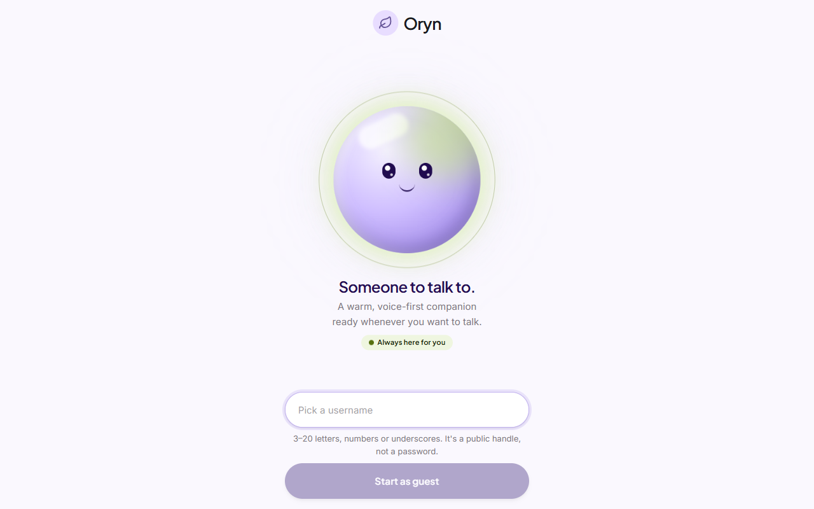
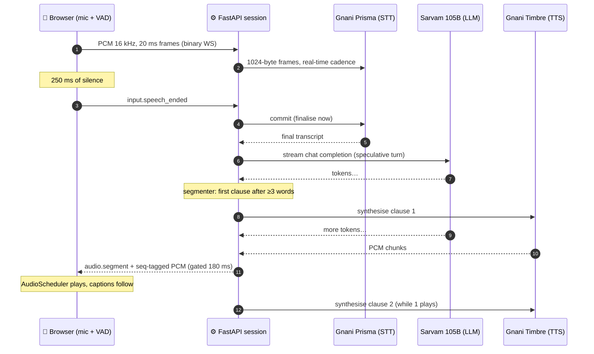
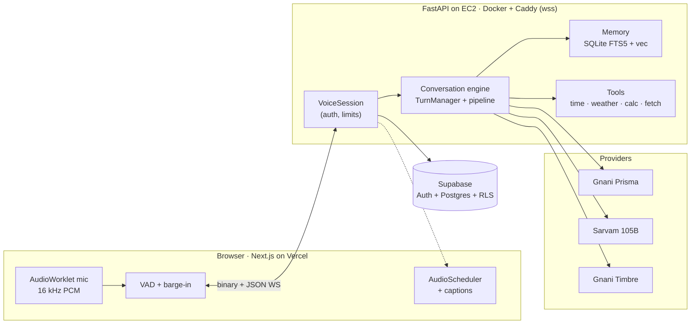

<div align="center">

# 🎙️ Oryn

### **An AI companion you can actually talk to.**

**A real-time, interruptible, multilingual voice agent — engineered for latency.**

**Gnani Prisma (STT) → Sarvam 105B (LLM) → Gnani Timbre (TTS), streamed end to end**

[](https://python.org)
[](https://fastapi.tiangolo.com)
[](https://nextjs.org)
[](https://supabase.com)
[](https://docs.gnani.ai)
[](https://docs.sarvam.ai)
[](LICENSE)

---

**Built for the Gnani AI Internship Challenge.** Speak naturally in English, Hindi, Hinglish or any of
ten Indian languages, interrupt whenever you like, and hear Oryn answer while it is still thinking.

[Live demo](https://oryn.app.builtbykrishna.dev) • [How it works](#-how-a-turn-flows) •
[Engineering](#-engineering-deep-dive) • [Performance](#-performance) • [Quick start](#-quick-start) •
[Contributing](#-contributing)



</div>

---

## 🎯 Overview

Most "voice bots" are a chatbot with a microphone bolted on: record → transcribe → wait for the whole
answer → synthesise → play. Every stage waits for the previous one to finish, so the user waits for the
sum of all of them.

Oryn is built the other way around. **Every stage streams into the next one and overlaps with it**,
cancellation is a first-class operation, and the client and server measure exactly where each
millisecond goes.

### What makes it different?

| | |
| :--- | :--- |
| ⚡ **Overlapped streaming pipeline** | The LLM starts on the final transcript, the first spoken clause goes to TTS after ~3 words, and audio plays while the rest is still being generated. |
| ✂️ **Real barge-in** | Talk over Oryn and it stops locally in milliseconds; a generation-id fence guarantees no stale audio ever plays (0 stale frames across every measured interrupt). |
| 🫶 **Human-style interruptions** | A "haan" or "hmm" doesn't kill a story — Oryn ducks, listens, and carries on. Real words make it stop and answer, without ever saying "you interrupted me". |
| 🎯 **Client-side endpointing** | The browser's VAD tells Prisma the moment you stop talking, instead of waiting for server-side silence detection. |
| 🌏 **10 languages + auto-detect** | Everything Gnani Prisma and Timbre share, with per-utterance language detection (`indic-auto`). |
| 🗣️ **42 voices** | Every Gnani Timbre voice, selectable and previewable in Settings, resolved per language. |
| 📝 **Captions in sync with speech** | Words appear as Oryn says them, aligned to the audio scheduler — not dumped as a wall of text. |
| 🧠 **Consent-gated memory** | Hybrid SQLite FTS5 + sqlite-vec retrieval fused with Reciprocal Rank Fusion, per-user isolated, off by default. |
| 📏 **Measured, not claimed** | p50/p95/p99 per stage on a protected `/metrics` endpoint, plus a benchmark harness that drives real speech through the real stack. |

---

## 🔄 How a turn flows



Barge-in takes the same path in reverse: the browser **ducks and listens** first, then either resumes
(backchannel) or hard-stops locally and sends `turn.cancel`. The server sets a synchronous
generation fence, cancels the turn's `TaskGroup` (LLM, segmenter, TTS, sender), and drops anything still
in flight.

---

## 🛠 Engineering deep dive

<details open>
<summary><b>1. Turn manager and the cancellation fence</b></summary>

`backend/app/conversation/turns.py` owns turn ids, generation ids and the one active turn. Cancelling
sets `live_generation = None` **before the first `await`**, so no later send — text, caption or audio —
can slip out for the old generation, even if a provider response is already in the event loop.
Stale `turn.cancel` messages (an older `generation_id`) are ignored, and cancels are idempotent. No lock
is ever held across a provider network call, so an interrupt can't queue behind an STT reconnect.
</details>

<details>
<summary><b>2. A bounded, back-pressured pipeline per turn</b></summary>

Each turn is one `asyncio.TaskGroup`:

```
LLM stream ──deltas──► Segmenter ──segments (maxsize 4)──► TTS worker ──PCM (≈2 s bound)──► Audio sender ──► WebSocket
```

A slow client blocks the sender, which fills the PCM buffer, which pauses the TTS read, which fills
the segment queue, which pauses reading the LLM stream. Memory stays flat no matter how long the reply.
Async generators are closed with `aclosing`, and `CancelledError` is never swallowed.
</details>

<details>
<summary><b>3. Endpointing and speculative turns</b></summary>

The browser VAD (adaptive noise floor, 120 ms to start, 250 ms of silence to end, ≥ 200 ms of speech)
sends `input.speech_ended`; the server immediately sends Prisma `commit`. When the transcript lands the
LLM starts at once, but audio is held for a **180 ms grace window**: if the user was only pausing
mid-thought, the speculative turn is cancelled silently and the transcripts are merged.
</details>

<details>
<summary><b>4. Segmenter tuned for speech</b></summary>

`backend/app/voice/segmenter.py` flushes the first clause after ≥ 3 words (or after 250 ms at a word
boundary), then follows sentences with a 160-character cap. It never splits numbers (`3.5`, `1,000`),
abbreviations (`Dr.`, `e.g.`) or URLs, understands the Devanagari danda `।`, merges tiny tails, and strips
markdown that a TTS would read aloud.
</details>

<details>
<summary><b>5. Interruption engine (backchannels vs. real interruptions)</b></summary>

`backend/app/voice/interruptions.py`: overlapping speech puts the turn in a *contested* state while the
client ducks playback to 20 %. The final transcript decides: a backchannel (`haan`, `hmm`, `ok`,
`achha`, `right`, laughter — Latin and Devanagari) → `turn.resume`; anything else → cancel and answer.
Speech longer than 700 ms is treated as a clear interruption on the client without waiting. The model
is told privately where it was cut off — never with a marker in its own history — so it can return to
its point naturally.
</details>

<details>
<summary><b>6. Protocol v2</b></summary>

One persistent WebSocket per conversation. JSON events carry an envelope
`{v, type, session_id, turn_id, generation_id, seq, ts}`; audio travels as binary frames with an 8-byte
`>II` header (`generation_id`, `seq`) — no base64. Auth is the first message (the Supabase JWT, verified
via JWKS for ES256), never a URL parameter.
</details>

<details>
<summary><b>7. Client audio scheduler and captions</b></summary>

`apps/web/lib/audio/AudioScheduler.ts` runs an `AudioContext` at the TTS sample rate (no resampling),
orders chunks by `seq`, adapts its lead from 40 ms up to 150 ms on underrun, and `stop()` silences
everything synchronously. `CaptionTrack` maps each `audio.segment` to the scheduled start time of its
first chunk and reveals words weighted by length as the audio plays.
</details>

<details>
<summary><b>8. Provider adapters</b></summary>

Vendor code lives only in `backend/app/providers/`. Prisma: exact 1024-byte framing, `speech_start` and
close-code mapping. Timbre: pooled keep-alive SSE (default) or a persistent WebSocket, behind an
account-wide slot; retries only before the first audio byte. Sarvam: streaming chat completions with
tool-call accumulation and reasoning disabled for latency. Everything else depends on
`providers/base.py` only — swapping a vendor touches one file.
</details>

---

## 📊 Performance

All numbers below were **measured live** against the real providers with
`backend/scripts/benchmark_pipeline.py`, which synthesises English, Hindi and Hinglish speech, streams it
into the running server at real-time cadence, and simulates the browser.

### Baseline: first working pipeline (v1)

```
+----------------------------------------------------------------+
|            SPEECH END -> FIRST AUDIO, v1 (p50, 2 runs)          |
+----------------------------------------------------------------+
|  STT (silence + finalise)  ████████████░░░░░░░░  1.08-1.20 s   |
|  LLM first token           ████░░░░░░░░░░░░░░░░  0.36 s        |
|  TTS first byte            ██████████░░░░░░░░░░  0.86-1.03 s   |
|  ─── perceived total ───── ████████████████████  2.15-2.38 s   |
+----------------------------------------------------------------+
|  p95 perceived: 3.2-6.7 s (Timbre spikes)                       |
+----------------------------------------------------------------+
```

| Metric | Value | Notes |
| :--- | :---: | :--- |
| Barge-in: interrupt → server stop | **4–10 ms** | 6/6 interrupts acknowledged |
| Stale audio frames after an interrupt | **0** | generation-id fence |
| LLM time to first token (Sarvam) | ~360 ms p50 | `reasoning_effort` off |
| Timbre time to first byte | 0.26–0.9 s p50 | varies run to run (see A/B) |

### What the optimisation targeted

| Bottleneck found by profiling | Fix |
| :--- | :--- |
| ~1.1 s waiting for server-side silence detection | client VAD → Prisma `commit` |
| LLM only started after endpointing confirmed | speculative turn + 180 ms audio gate |
| First TTS request waited for a full sentence | first-clause flush at ≥ 3 words / 250 ms |
| Interrupts could wait behind a lock held during STT reconnect | synchronous cancel fence, no lock across I/O |
| Unbounded queues | every queue bounded; back-pressure end to end |
| Metric hid STT time | perceived latency measured in the browser from the last voiced frame |

### Timbre transport A/B (TTFB p50, ms, n = 40 per cell)

| Run | SSE 16 kHz | WS 16 kHz | SSE 24 kHz | WS 24 kHz |
| :---: | :---: | :---: | :---: | :---: |
| 1 | 320 | 261 | 637 | 245 |
| 2 | 823 | 734 | 899 | 644 |
| 3 | 325 | 447 | 444 | 327 |
| 4 | 320 | 278 | 263 | 377 |

The WebSocket/SSE gap flips sign between runs and is smaller than the provider's own drift, and the
WebSocket recovers slower after a barge-in (it must reconnect) — so **SSE stays the default**, chosen by
data rather than assumption.

---

## 🏗️ Architecture



### Tech stack

| Layer | Technology |
| :--- | :--- |
| Frontend | Next.js 16, React 19, TypeScript, Tailwind, Web Audio / AudioWorklet |
| Backend | Python 3.12, FastAPI, asyncio `TaskGroup`, Pydantic v2, httpx, websockets |
| Speech | Gnani Prisma (STT, `prisma-v3.0`), Gnani Timbre (TTS, `timbre-v2.5`, 42 voices) |
| Language model | Sarvam `sarvam-105b-conversations` (streaming, tool calling) |
| Data | Supabase Auth (guest + Google) and Postgres with RLS; SQLite + FTS5 + sqlite-vec for memory |
| Infra | Docker (non-root), Caddy auto-HTTPS, AWS EC2 `ap-south-1`, Vercel |
| CI/CD | GitHub Actions: ruff, mypy, pytest, web lint/typecheck/tests/build, Docker build, gitleaks, pip-audit → GHCR → SSH deploy with health check and rollback |

### Project structure

```
oryn/
├── apps/web/                 # Next.js client
│   ├── lib/audio/            # MicCapture, VAD, AudioScheduler, BargeInDetector
│   ├── lib/realtime/         # protocol v2 types, RealtimeClient, generation gate
│   ├── lib/captions/         # speech-synced captions
│   └── tests/                # node --test suites
├── backend/
│   ├── app/
│   │   ├── conversation/     # engine, TurnManager, pipeline, context, prompts, summary
│   │   ├── voice/            # state machine, segmenter, interruptions, latency, voice catalogue
│   │   ├── providers/        # Gnani Prisma/Timbre, Sarvam, embeddings, fakes
│   │   ├── websocket/        # protocol v2, session
│   │   ├── memory/ tools/    # hybrid memory + tool registry
│   │   └── auth/ persistence/
│   ├── scripts/              # benchmark_pipeline.py, tts_ab.py, verify_languages.py
│   └── tests/
├── infra/                    # docker-compose, Caddyfile, EC2 bootstrap + deploy scripts
├── supabase/migrations/
└── .github/workflows/        # ci.yml, deploy.yml
```

---

## 🚀 Quick start

### 1. Backend

```bash
git clone https://github.com/krishna-notfound/Oryn.git && cd Oryn/backend
python -m venv .venv && source .venv/bin/activate      # Windows: .venv\Scripts\activate
pip install -e ".[dev]"
cp .env.example .env                                     # fill in keys (see below)

# no keys? run fully offline with deterministic fake providers
PROVIDER_MODE=fake uvicorn app.main:build_app --factory --reload --port 8000
```

### 2. Web app

```bash
cd ../apps/web
npm install
cp .env.example .env.local     # Supabase URL + publishable key, backend ws/http URLs
npm run dev                    # http://localhost:3000
```

### 3. Database

Apply `supabase/migrations/*.sql` to your Supabase project and enable **anonymous sign-ins**
(Authentication → Sign In / Providers) for guest mode.

### Environment variables (backend)

| Variable | Purpose |
| :--- | :--- |
| `GNANI_API_KEY`, `GNANI_TTS_VOICE` | Prisma + Timbre (one key for both) |
| `SARVAM_API_KEY`, `LLM_MODEL` | Sarvam chat completions (default `sarvam-105b-conversations`) |
| `SUPABASE_URL`, `SUPABASE_SERVICE_ROLE_KEY` | JWT verification (JWKS) and server-side persistence |
| `EMBEDDINGS_BASE_URL`, `EMBEDDINGS_API_KEY`, `EMBEDDINGS_MODEL`, `EMBEDDINGS_DIMENSIONS` | optional semantic memory (any OpenAI-compatible endpoint) |
| `GNANI_TTS_TRANSPORT` | `sse` (default) or `ws` |
| `METRICS_TOKEN` | bearer token for `/metrics` (endpoint closed when unset) |
| `PROVIDER_MODE` | `live` or `fake` |

### Run the tests and the benchmark

```bash
cd backend && pytest -q -m "not live"          # unit + integration with fake providers
pytest -m live                                  # real providers (needs keys)
python scripts/benchmark_pipeline.py --help     # end-to-end latency against a running server
cd ../apps/web && npm test && npm run build
```

---

## 🔐 Security and privacy

- Provider keys live only on the backend; the browser never sees them.
- The WebSocket authenticates with the first message, never a URL token; every query is scoped to the
  verified user id; Postgres RLS on every table.
- No raw audio is stored and no transcripts are logged.
- Memory is opt-in, user-editable and deletable; the agent's `fetch_webpage` tool blocks private
  networks and DNS rebinding, and treats fetched text as untrusted.
- Oryn is a companion, not a therapist: crisis language triggers a careful response pointing to
  trusted people and Tele-MANAS (14416) in India.

---

## 🤝 Contributing

Contributions are welcome — bug reports, provider adapters, languages, latency ideas backed by
numbers. Please read [CONTRIBUTING.md](CONTRIBUTING.md) first. In short: open an issue, branch as
`feature/<what-it-does>`, keep CI green (`ruff`, `mypy`, `pytest`, web lint/typecheck/tests), and
include benchmark output for anything that claims to be faster.

## 🗺️ Roadmap

- Higher Timbre concurrency → prefetch the next sentence while the current one plays
- Semantic turn detection (smart endpointing) alongside VAD
- Google sign-in (code ready behind `NEXT_PUBLIC_GOOGLE_AUTH_ENABLED`)
- Web search tool with a verified provider

## 📚 References

- [Gnani AI docs — Prisma STT and Timbre TTS](https://docs.gnani.ai)
- [Sarvam AI docs — chat completions](https://docs.sarvam.ai)
- [Supabase anonymous sign-ins](https://supabase.com/docs/guides/auth/auth-anonymous)
- [Reciprocal Rank Fusion (Cormack et al.)](https://plg.uwaterloo.ca/~gvcormac/cormacksigir09-rrf.pdf)
- [Python `asyncio.TaskGroup`](https://docs.python.org/3/library/asyncio-task.html#task-groups)

## 📄 License

MIT — see [LICENSE](LICENSE). Use it, fork it, build your own voice agent on it.

---

<div align="center">

**Built by [Krishna](https://github.com/krishna-notfound)** · if Oryn helped you, give it a ⭐

</div>
